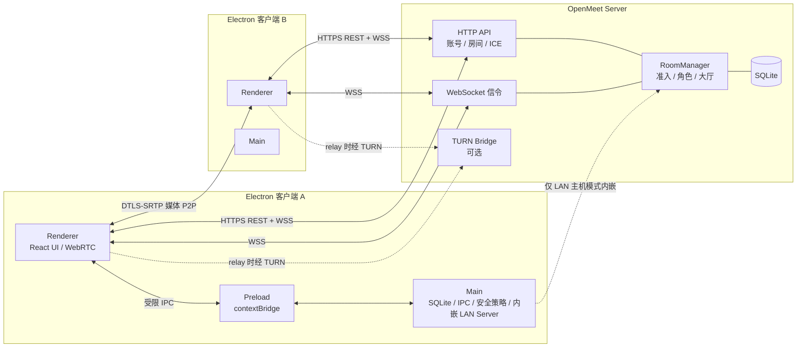

# OpenMeet 概要设计

> 版本：0.1.0 ｜ 状态：实现基线 ｜ 最后更新：2026-10-22

## 1. 项目定位

OpenMeet 是一个**开源、可自托管、局域网优先**的桌面视频会议软件。它不依赖任何中心化商业服务：

- 桌面端：Electron + React + WebRTC，主进程持有 SQLite 本地存储与系统能力。
- 服务端：Node.js 单进程，提供账号、房间、访问控制、WebSocket 信令与可选的 TURN 桥接。
- 网络：优先直连（IPv4 / IPv6 局域网），跨 NAT 使用 STUN，失败时可通过 TURN 中继（桥接）。
- 两种开会形态：
  1. **服务器会议**：加入自托管 OpenMeet Server，支持账号、历史、跨网络会议。
  2. **局域网会议**：无需账号和公网服务器，主机的桌面端内嵌同一套服务端内核，嘉宾凭邀请加入。

### 1.1 目标

| 目标 | 说明 |
| --- | --- |
| 真正可用 | 登录、开会、音视频、屏幕共享、聊天、主持管理形成闭环 |
| 数据自主 | 账号与会话数据在自己的服务器；历史与聊天在本地；无遥测 |
| 部署简单 | 服务端零原生依赖，Node ≥ 22.5 直接运行，SQLite 落盘 |
| 连接灵活 | IPv4/IPv6 直连、STUN 穿透、TURN 桥接、可强制仅中继 |
| 安全边界清晰 | 渲染进程沙箱化、刷新令牌加密、房间密码/等候室/锁定/踢人 |
| 可维护 | 共享协议包保证端到端类型一致，关键逻辑有自动化测试 |

### 1.2 非目标（v0.1）

- **不是 SFU/MCU**：多人会议采用 WebRTC Mesh，建议 2–6 人，硬上限默认 8 人可配置到 12 人。
  这里的“桥接”指 TURN 媒体中继，用于连通性，不承担大规模混流。
- 不做云端录制、直播推流、电话拨入、移动端、Web 端。
- 不宣称可验证的端到端加密：媒体链路为 DTLS-SRTP 加密，但信令服务器在信任域内；
  可验证 E2EE（SAS/Insertable Streams）列入路线图。
- 不做企业级多租户、SSO、审计合规套件。

## 2. 角色与使用场景

| 角色 | 能力 |
| --- | --- |
| 注册用户 | 登录服务器、创建/加入会议、查看历史、修改显示名 |
| 主持者 Host | 房间创建者；锁定房间、管理等候室、静音/移出成员、设置联席主持、结束会议 |
| 联席主持 Co-host | 除结束会议外的管理能力（按服务端授权） |
| 嘉宾 Guest | 凭邀请令牌加入；可设房间密码与等候室审核；无需账号 |
| 局域网主机 | 使用内嵌服务器创建会议，本机即信令点；关闭应用即会议终止 |
| 运维者 | 部署 OpenMeet Server，配置 TLS、STUN/TURN、注册策略与数据目录 |

典型流程：

1. 运维者部署服务端并注册首个账号。
2. 用户在桌面端填写服务器地址，登录或注册。
3. 用户创建会议，选择密码、等候室、人数上限，复制邀请。
4. 受邀者粘贴邀请内容，输入昵称/密码，经等待室进入。
5. 各端通过信令交换 SDP/ICE，媒体走 P2P；NAT 失败时走 TURN。
6. 主持者可锁定房间、审核进入、静音或移出成员，结束后房间销毁。
7. 本地 SQLite 记录会议历史与聊天；服务端记录账号与参会摘要。

## 3. 总体架构

### 3.1 组件职责

**packages/shared（协议包）**
- REST/WS 消息类型、运行期校验、错误码。
- 房间码规范化、邀请载荷编码/解码。
- ICE 配置结构、协议常量。

**packages/server（自托管服务端）**
- `http.ts`：HTTP 路由、CORS、安全响应头、JSON 大小限制、限流。
- `auth.ts`：scrypt 密码、HS256 JWT、刷新令牌轮换。
- `rooms.ts`：房间状态机、大厅、角色、主持迁移、信令校验与转发。
- `turn.ts`：内嵌 node-turn 或 coturn REST 凭据。
- `db.ts`：node:sqlite 持久化、迁移、PRAGMA。
- 同一进程既服务远程部署，也作为 Electron 主进程内的嵌入式 LAN Server，
  避免两套信令实现产生行为差异。

**packages/desktop（Electron 客户端）**
- 主进程：窗口、权限策略、CSP、单实例、深链、SQLite、safeStorage、内嵌服务启动、屏幕源枚举。
- 预加载：暴露最小化、类型化的 `window.openmeet` API。
- 渲染进程：登录/注册、首页、预检、会议、聊天、成员、设置、历史；WebRTC Mesh；WS 重连。

### 3.2 数据与信任边界

| 数据 | 位置 | 说明 |
| --- | --- | --- |
| 密码 | 只传输给所选服务器 | scrypt 散列存储；客户端不落盘 |
| 访问令牌 | 内存 | 20 分钟，Bearer |
| 刷新令牌 | 服务器散列 + 客户端 safeStorage 加密 | 30 天，轮换 |
| 会议历史/聊天 | 客户端 SQLite | 明文本地库（按用户系统账户保护） |
| 账号/房间摘要 | 服务端 SQLite | 不保存聊天正文 |
| 邀请令牌 | 不落库；HMAC 派生 | 能力凭证，等同“进门钥匙” |
| 媒体 | P2P / TURN 中继 | DTLS-SRTP 加密；TURN 无法解密内容 |

## 4. 部署形态

### 4.1 公网自托管

- 单台服务器运行 Node 服务端，前置 Caddy/Nginx 提供 TLS 与 WebSocket 转发。
- STUN 建议使用服务端配置的公共 STUN；TURN 可使用内嵌 node-turn（UDP 3478）
  或专业 coturn（推荐生产，支持 turns/TCP）。
- 客户端通过 `https://meet.example.com` 连接，邀请链接/邀请码可跨网络分享。

### 4.2 纯局域网 / 离线

- 无账号模式：主机点击“局域网会议”，主进程按需启动内嵌服务端，绑定全部网卡。
- 邀请载荷携带房间 ID、邀请令牌与候选 HTTP 端点（非回环 IPv4 与全局 IPv6）。
- 受邀端并发探测端点并选择最快可用者；随后 WebSocket 信令 + P2P 媒体。
- 不依赖公网；如无 STUN/TURN 仍可在同网段直连。
- 主机退出应用即失去信令点，房间终止。

### 4.3 混合

- 已登录用户可创建服务器会议，也可创建局域网直连会议。
- 服务端可通过环境变量强制关闭访客、限制房间人数、关闭注册。

## 5. 网络与媒体策略

| 场景 | 候选 | 说明 |
| --- | --- | --- |
| 同一局域网 IPv4 | host 候选 | 最快路径 |
| 同一局域网 IPv6 | host 候选 | 服务端双栈监听，客户端收集 IPv6 候选 |
| 跨 NAT | srflx（STUN） | 默认 STUN 可配置；离线部署可关闭 |
| 对称 NAT / UDP 封锁 | relay（TURN） | “桥接”模式；可强制 `iceTransportPolicy=relay` |
| 企业防火墙 | turns/TCP（coturn） | 内嵌 node-turn 仅 UDP，生产建议 coturn |

设计取舍：

- Chromium 默认用 mDNS 混淆本地 IP；Electron 启动时关闭该特性，
  以便真正的局域网 host 候选可用，同时在文档中说明隐私影响。
- 每对成员建立独立 RTCPeerConnection（Mesh）。
- 每条连接固定三条媒体线：音频、摄像头视频、屏幕共享视频。
  屏幕共享通过 `replaceTrack` 复用预留的视频线，避免反复重协商。
- 摄像头/麦克风“关闭”通过 `track.enabled=false` 实现，配合 `media` 状态广播，
  远端据此显示头像而非黑帧。带宽优化（replaceTrack(null)）列入路线图。
- 不采集系统声音；屏幕共享仅视频。音频回放由独立隐藏 `<audio>` 承载，避免重复播放。

## 6. 安全与访问控制

1. **账号安全**：scrypt（N=32768, r=8, p=1）加盐散列；登录限流；注册可关闭。
2. **令牌**：短时访问 JWT + 可轮换刷新令牌（服务端只存 SHA-256）；重放旧刷新令牌即失效。
3. **本地令牌**：刷新令牌经 Electron `safeStorage`（Windows DPAPI / macOS Keychain）加密后入库；
   不可用时降级并在设置页提示风险。
4. **房间准入**：
   - 房间码：9 位易读字符，用于已登录同服务器用户加入。
   - 邀请令牌：HMAC-SHA256 派生能力令牌，用于嘉宾加入。
   - 房间密码：scrypt 散列；主持者与持有正确密码者通过。
   - 等候室：嘉宾进入等候区，主持者/联席主持逐个放行。
   - 锁定：阻止一切新加入（主持者除外）。
   - 踢出与角色变更由服务端校验操作者身份后广播。
5. **渲染进程**：`contextIsolation=true`、`nodeIntegration=false`、`sandbox=true`、
   仅开放白名单 IPC；媒体权限仅授予本应用页面；CSP 限制脚本来源。
6. **服务端**：请求体大小限制、WS 帧大小限制、按 IP 限流、消息速率限制、
   常量时间比较签名/令牌、CORS 可配置、安全响应头。
7. **隐私**：无遥测；聊天不写服务端；日志默认不记录令牌、密码、SDP 正文。

### 明确的安全限制

- 信令服务器是信任根：理论上可实施中间人替换。当前不做可验证 E2EE。
- 邀请令牌即能力凭证，泄露后可加入房间（仍受密码/等候室/锁定约束），
  需通过重新创建房间来失效。
- 内嵌 TURN 使用静态凭据且仅 UDP，适合小规模/临时部署；生产请用 coturn 短时凭据。
- 本地 SQLite 不做整库加密；依赖操作系统账户边界与磁盘加密。

## 7. 技术选型

| 领域 | 选型 | 理由 |
| --- | --- | --- |
| 桌面容器 | Electron 45 | 成熟 WebRTC/屏幕捕获；主进程可使用 Node |
| UI | React 19 + Zustand + 原生 CSS | 状态集中、依赖少、视觉可控 |
| 构建 | electron-vite 6 / Vite 8 | 主/预加载/渲染三端统一构建，HMR |
| 数据库 | Node 内置 `node:sqlite` | 服务端与 Electron 主进程共用，零原生编译 |
| 服务端 HTTP/WS | 原生 `http` + `ws` | 依赖极少，路由面上限明确 |
| 密码/JWT | 原生 `crypto` | 避免重量级依赖，便于审计 |
| TURN | 可选 `node-turn` / coturn | 开箱可桥接；生产可替换 |
| 媒体 | 浏览器原生 WebRTC (Mesh) | 无需媒体服务器，隐私与成本友好 |

## 8. 容量与性能预期

- 单房间建议 ≤ 6 人，默认上限 8；每增加一人，每端多一路上行。
- 典型 720p@30fps 摄像头 + 1080p 屏幕共享，单路上行约 1–3 Mbps；
  Mesh 下上行随人数线性增长，超过 6 人应改用 SFU（路线图）。
- 服务端只转发小体积 JSON 信令，单核可承载大量并发房间；主要成本是连接数。
- 内嵌 TURN 为单进程 UDP 转发，仅建议小规模；带宽与端口范围需运维规划。

## 9. 风险与缓解

| 风险 | 缓解 |
| --- | --- |
| 对称 NAT / 企业防火墙导致媒体不通 | STUN + TURN；前端展示 ICE 状态；支持仅中继模式 |
| IPv6 链路本地地址作用域/防火墙 | 邀请只发布 IPv4 与全局 IPv6；链路本地地址需要 zone id，URL 解析不接受，故不写入邀请 |
| 主机休眠/关闭导致 LAN 会议中断 | UI 明示“主机需保持在线”；路线图支持常驻桥接 |
| Mesh 上行压力 | 人数上限、码率上限、清晰度档位（路线图 SFU） |
| 邀请泄露 | 房间密码、等候室、锁定；重建房间使旧令牌失效 |
| 令牌被本地窃取 | safeStorage 加密刷新令牌；访问令牌仅内存、短时效 |
| 服务端重启导致进行中会议中断 | 启动时标记旧房间结束；文档提示滚动升级窗口 |

## 10. 里程碑

- **v0.1（本项目）**：账号、房间、信令、Mesh 音视频、屏幕共享、聊天、等候室、
  主持管理、本地历史、LAN 内嵌服务、STUN/TURN、自托管部署文档与测试。
- **v0.2**：设备热切换、屏幕共享系统音频、会议内邀请、聊天服务端可选持久化、深链完善、自动更新。
- **v0.3**：SFU 桥接服务（选择性转发）、可验证 E2EE、录制。
- **v1.0**：多平台安装包、可观测性、审计与备份工具。

详细流程、状态机与实现约束见《02-详细设计》，协议字段以《03-接口规范》为准。
