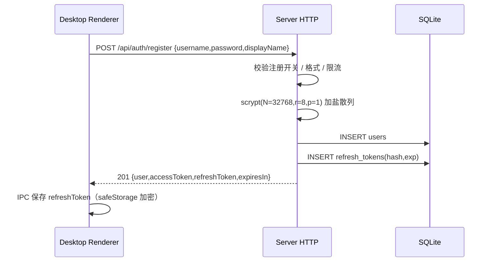
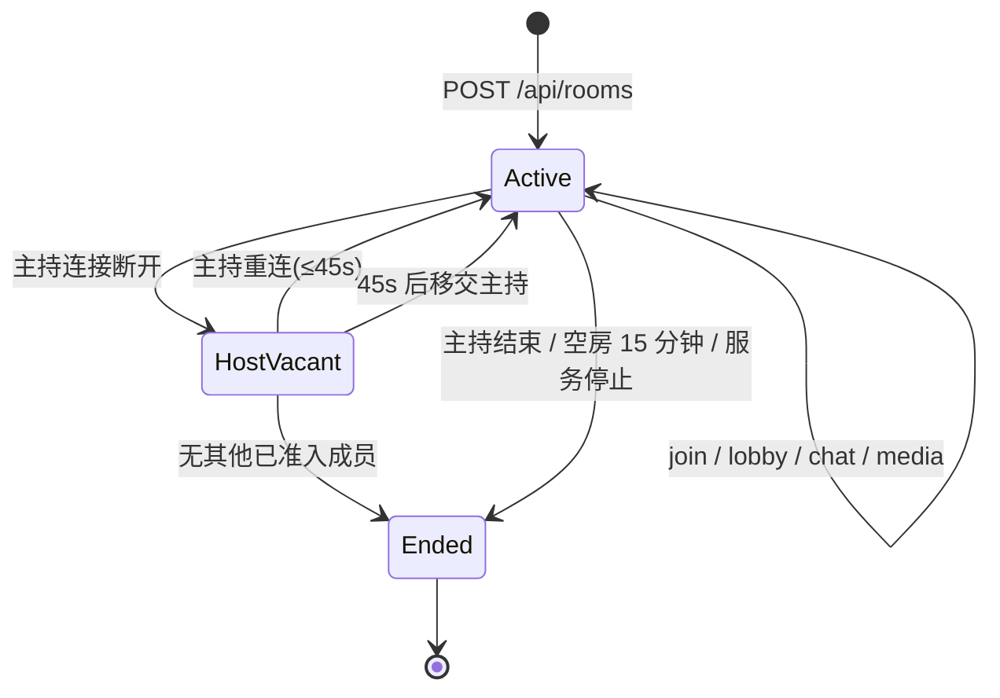
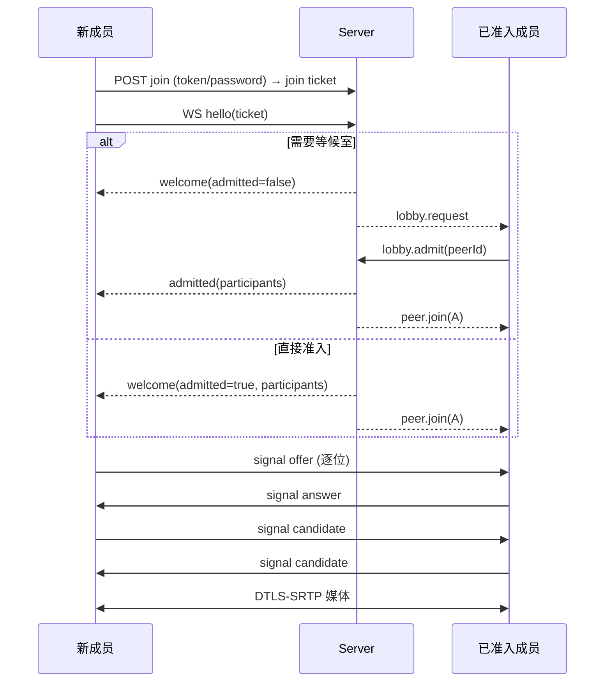

# OpenMeet 详细设计

> 对应版本：0.1.0 ｜ 协议版本：1 ｜ 最后更新：2026-10-22

## 1. 仓库结构

```
OPENMEET/
├─ package.json                 # npm workspaces 根
├─ docs/                        # 设计、协议、数据、部署文档
├─ packages/
│  ├─ shared/                  # 端到端共享类型与纯函数
│  │  └─ src/{types,protocol,invite,codes,errors}.ts
│  ├─ server/                  # 可自托管服务端 / 内嵌 LAN 服务内核
│  │  ├─ src/
│  │  │  ├─ index.ts           # startServer 导出 + CLI 入口
│  │  │  ├─ config.ts          # 环境变量 → 配置
│  │  │  ├─ db.ts              # node:sqlite、迁移、查询
│  │  │  ├─ auth.ts            # scrypt / JWT / 刷新令牌
│  │  │  ├─ rooms.ts           # RoomManager 状态机 + WS 处理
│  │  │  ├─ http.ts            # 路由、CORS、限流、静态信息
│  │  │  ├─ ice.ts             # STUN/TURN 配置与凭据
│  │  │  ├─ turn.ts            # 内嵌 node-turn 生命周期
│  │  │  └─ log.ts
│  │  ├─ test/                 # node:test 集成测试
│  │  └─ types/node-turn.d.ts
│  └─ desktop/
│     ├─ electron.vite.config.ts
│     ├─ src/main/             # Electron 主进程
│     │  ├─ index.ts           # 生命周期、窗口、单实例、深链
│     │  ├─ window.ts          # BrowserWindow + 权限 + 屏幕共享
│     │  ├─ db.ts              # 本地 SQLite 迁移与仓储
│     │  ├─ ipc.ts             # 白名单 IPC
│     │  ├─ session.ts         # safeStorage + refresh 代理
│     │  ├─ lan.ts             # 内嵌服务生命周期
│     │  └─ endpoints.ts       # 网卡地址收集
│     ├─ src/preload/index.ts  # contextBridge
│     └─ src/renderer/         # React UI
│        ├─ lib/{api,ws,rtc,media,store}.ts
│        ├─ screens/
│        └─ components/
├─ Dockerfile
├─ docker-compose.yml
└─ README.md
```

## 2. 进程与线程模型

### 2.1 Electron

- **main**（Node.js）：
  - 唯一 SQLite 持有者；渲染层不接触文件系统与 Node。
  - 持有刷新令牌，负责刷新请求，避免 refresh token 进入页面上下文。
  - 按需启动内嵌 LAN Server（同一 Node 进程内），并收集局域网端点。
  - 屏幕源枚举、显示媒体请求决策、权限策略、CSP、单实例与深链。
- **preload**：`contextBridge` 暴露 `window.openmeet`，只包含方法，不暴露 `ipcRenderer`。
- **renderer**（Chromium）：
  - React UI、REST 客户端、WebSocket 信令、RTCPeerConnection、媒体采集与渲染。
  - `sandbox: true`、`contextIsolation: true`、`nodeIntegration: false`。
  - 所有远端输入按不可信处理。

### 2.2 Server

- 单 Node 进程：HTTP + WebSocket 共用一个 `http.Server`。
- `RoomManager` 全部在内存中维护活跃房间，SQLite 只做账号、房间摘要、参会记录。
- 所有房间操作在事件循环内串行执行，无需锁；异步散列（scrypt）在
  libuv 线程池执行，避免阻塞信令。
- 进程重启后活跃房间不可恢复：启动时把所有 `active` 房间标记为 `ended(server_restart)`。

## 3. 鉴权与会话设计

### 3.1 注册 / 登录



- 用户名 3–32 位 `[a-zA-Z0-9_.-]`，存储小写，唯一（NOCASE）。
- 密码 8–128 字符；显示名 1–40 字符；首个注册用户可选设为 admin。
- 刷新令牌：48 字节随机值，服务端只存 SHA-256；30 天有效。
- **轮换与重放检测**：刷新时吊销旧令牌并签发新令牌；若收到已吊销令牌，
  吊销该用户全部刷新令牌并返回 `invalid_token`。
- 访问令牌：HS256 JWT，20 分钟，claims：`typ=access, sub, name, role, jti, iat, exp`。

### 3.2 客户端会话恢复

1. 启动读取 SQLite `sessions`（每个服务器一条），用 `safeStorage` 解密 refresh token。
2. 渲染层通过 IPC `session:refresh` 请求主进程刷新；主进程 HTTP 调用服务器，
   轮换后立即加密回写，仅把 access token 返回渲染层。
3. 失败则回到登录页并保留服务器地址；不在渲染层保存 refresh token。
4. 登出：调用 `/api/auth/logout` 吊销 refresh token（尽力而为），清除本地会话和内存令牌。

### 3.3 房间加入凭证（Join Ticket）

`POST /api/rooms/:code/join` 或内嵌 `POST /api/lan/join` 成功后签发 **join JWT**：

- 有效期 4 小时，`typ=join`，包含 `roomId`、`sid`（会话 ID）、`name`、
  `guest`、可选 `userId`、`host`（是否主持凭证）。
- 渲染层随后用 `hello` 把 ticket 发送到 `/ws`；服务端校验到房间、有效期、封禁名单。
- 等候室审核状态按 `roomId + sid` 记录在内存，断线重连（同一 ticket）不会重复排队。
- ticket 是能力凭证：不上日志、不放 URL、只存内存。

### 3.4 邀请令牌

- 远程与 LAN 统一：`inviteToken = base64url(HMAC-SHA256(secret, "invite:" + roomId))`。
- 服务端不落库，可重复派发给主持者；房间结束/服务端重启后随房间消失。
- 嘉宾加入必须同时提供房间码（或 LAN roomId）、邀请令牌、显示名；
  仍受密码、等候室、锁定、人数限制约束。
- 已登录用户加入同服务器房间只需房间码（密码/等待室照常）。

## 4. 房间生命周期与访问控制

### 4.1 状态机



- 空房计时：创建后 15 分钟无人加入，或最后一人离开 15 分钟后结束。
- 主持断线：保留 45 秒宽限；超时后按“联席主持优先、最早加入者其次”移交；
  若没有已准入成员则结束房间。
- 主持主动“离开”：立即移交或结束；只有主持（或临时代理）能结束会议。
- 结束房间：写库 `status=ended`，广播 `room.ended`，关闭所有连接。

### 4.2 角色与权限

| 操作 | Host | Co-host | Participant | Guest(已准入) |
| --- | :-: | :-: | :-: | :-: |
| 锁定/解锁房间 | ✓ | ✓ | ✗ | ✗ |
| 审核/拒绝等候室 | ✓ | ✓ | ✗ | ✗ |
| 静音他人 | ✓ | ✓（不含主持/联席） | ✗ | ✗ |
| 移出成员 | ✓ | ✓（不含主持/联席） | ✗ | ✗ |
| 设置联席主持 | ✓ | ✗ | ✗ | ✗ |
| 结束会议 | ✓ | ✗（主持空缺时例外） | ✗ | ✗ |

服务端是唯一权威：所有管理动作重新校验操作者角色与目标关系，客户端隐藏按钮只是体验优化。

### 4.3 人数与容量

- 默认上限 8，可配置最大 12；创建时可在 2..上限 之间选择。
- 容量统计包含已准入与等候中成员（防止等候室无限膨胀）。
- 达到容量后新请求返回 `room_full`；踢人后可再进。

## 5. 信令与 WebRTC

### 5.1 加入时序



- **新加入者向每个既有成员发起 offer**；既有成员只准备 PeerConnection，不主动 offer。
- 服务端先向既有成员广播 `peer.join`，再向新成员发送 `welcome`，保证事件顺序；
  客户端对“未知 peer 的 offer”做短暂缓冲，防止极端抖动。
- 信令消息严格定向：服务端只允许转发给同房间已准入成员，拒绝任意广播。

### 5.2 Perfect Negotiation

- 每条连接使用标准 perfect negotiation：`polite` 由双方 peerId 字典序决定。
- 双方都会在建连时挂上本地轨道；polite 侧在拿到 remoteDescription 前不发起首次 offer，
  避免两端同时 offer。
- 冲突（glare）处理：impolite 侧忽略撞车的 offer；polite 侧先 `setLocalDescription({type:'rollback'})`
  再接受对方 offer，否则信令会卡在 `have-local-offer`。
- ICE 候选在 remoteDescription 之前到达时按异常吞掉；同一 WebSocket 上 offer 一定先于其候选，
  因此不做额外缓冲。
- `connectionState=failed` 时任一侧触发 `restartIce()`，两次重启间隔至少 10 秒。
- 信令连接断开：指数退避重连（600ms 起，倍增，上限 12 秒，不限次数），使用同一 ticket；
  重连成功后重建全部 PeerConnection。用户离开/房间结束/被踢不再重连。

### 5.3 媒体线设计

每条 PeerConnection 固定创建三条 transceiver：

| 顺序 | 用途 | 初始方向 | 关闭方式 |
| --- | --- | --- | --- |
| 0 | 麦克风 | sendrecv | `track.enabled=false` + media 状态 |
| 1 | 摄像头 | sendrecv | `track.enabled=false` + media 状态 |
| 2 | 屏幕共享 | sendrecv | `sender.replaceTrack(null)` + media 状态 |

- 双方各自创建三条 transceiver 并挂载当前已有的本地轨道；缺少轨道的 m-line 仍会协商，
  因此两条连接上可能出现 6 条 m-line（本端 3 + 对端 3），这是 unified plan 的正常结果。
- 屏幕共享：`getDisplayMedia` → 第三路 `replaceTrack(track)` 并 `setStreams(screenStream)`，
  随后由 `negotiationneeded` 完成重协商；停止共享恢复 `null`。`contentHint='detail'`。
- 关闭摄像头/麦克风保留轨道（黑帧/静音），便于瞬时恢复；UI 用 media 状态隐藏画面。
- 音频只通过隐藏 `<audio>` 元素播放，视频元素全部 `muted`，避免重复回放。
- 远端流映射不能依赖 m-line 顺序或 `event.streams[0]`：应答侧为对端 m-line 新建的
  transceiver 与本端对象不同，且没有轨道的 m-line 会以 `msid "-"` 下发，其关联的
  MediaStream 可能不包含真正到达的轨道。实现按 transceiver 对象记录槽位
  （音频 / 摄像头 / 屏幕），并绑定 `transceiver.receiver.track`；轨道 `ended` 与每次
  协商结束后再校正一次槽位，保证第二次共享屏幕仍能渲染。

### 5.4 ICE 与“桥接”

- `IceConfig` 由服务端在 create/join 响应下发；客户端可在设置中叠加自定义 TURN 与
  `iceTransportPolicy=relay`（仅桥接）。
- STUN 默认 `stun:stun.l.google.com:19302`，可配置为内网 STUN 或关闭。
- 内嵌 TURN（node-turn）：UDP 3478，静态用户名/密码，需配置公网/局域网可达主机名；
  需要 `OPENMEET_TURN_MODE=embedded` 且安装可选依赖。
- coturn 模式：服务端用共享密钥生成短时 REST 凭据（TTL 默认 12 小时），
  推荐生产使用，支持 UDP/TCP/TLS。
- LAN 模式默认不启动 TURN，纯直连；跨网段需求请使用服务器会议。

### 5.5 局域网内嵌服务

- 主机首次创建 LAN 会议时，主进程按需 `startServer({mode:'lan'})`：
  - 绑定 `::`（失败回退 `0.0.0.0`），端口默认 45871，占用则顺延。
  - SQLite 使用 `:memory:`；不开放账号接口；房间仅存于进程生命周期。
  - 合成 `lan-host` 用户满足房间表约束；主持 ticket 由主进程直接签发。
- 端点收集：非回环 IPv4 与全局 IPv6，去重后写入邀请载荷；链路本地 `fe80::` 需要
  zone id，而 WHATWG URL 解析不接受带 zone 的主机名（Node 与 Chromium 都会判定为
  Invalid URL），因此不作为端点发布。受邀端并发请求 `/api/lan/join`，首个成功者胜出。
- 内嵌服务器在应用退出、房间结束或主进程崩溃时消失；UI 明确提示主机需保持在线。
- Chromium 启动参数关闭 mDNS 本地 IP 混淆，否则局域网 host candidate 会成为
  `.local` 主机名，降低直连成功率；这是有意的隐私权衡，写入隐私说明。

## 6. 客户端实现

### 6.1 状态与界面

`zustand` 存储可序列化状态：

- `boot | auth | home | prejoin | meeting | history` 顶层界面。
- 会话：`serverUrl / user / accessToken / mode(server|local)`。
- 预检：`joinContext`（来源、房间摘要、ticket、ice、邀请载荷、是否需要密码/昵称）。
- 会议：`room / self / participants / pending / messages / mediaState / activePanel /
  connection / remoteStreams / localStream / screenStream`。
- 媒体流为非序列化对象，直接存放在 store，组件通过 selector 订阅。

界面结构：

| 界面 | 要点 |
| --- | --- |
| 登录 | 品牌区 + 表单；服务器探测、注册开关、局域网模式入口 |
| 首页 | 侧栏（首页/历史/设置）、开始会议、加入会议、最近会议、账号 |
| 预检 | 摄像头预览、设备选择、昵称、麦克风/摄像头开关、密码与错误提示 |
| 会议 | 视频网格/共享演讲者布局、底部控制条、聊天/成员侧栏、邀请弹窗、等候室提示 |
| 等候室 | 房间信息、等待动画、取消 |
| 设置 | 身份、设备、网络（仅中继/自定义 TURN）、数据清理、关于 |
| 历史 | 本地会议记录、时长、参与人数、聊天条数；可凭房间码重新加入 |

设计语言：深墨绿背景、薄荷绿主色、暖琥珀强调；无渐变滥用、无假数据仪表盘；
所有交互有 hover/focus/disabled 状态；空状态有明确行动按钮。

### 6.2 Electron 安全配置

- `BrowserWindow`：
  - `contextIsolation: true`、`nodeIntegration: false`、`sandbox: true`。
  - `webSecurity: true`；禁用新窗口，外链交给系统浏览器。
  - `titleBarStyle: hidden` + `titleBarOverlay`（Windows/Linux），macOS `hiddenInset`。
- 权限：
  - `setPermissionRequestHandler`：仅对本应用页面允许 `media`、`display-capture`、
    `clipboard-sanitized-write`。
  - `setPermissionCheckHandler`：仅本应用页面的 `media`、`display-capture` 返回 true。
  - `setDisplayMediaRequestHandler`：只允许用户在当前会话选择的屏幕源。
- IPC：固定通道名，参数运行期校验；渲染层不能传任意路径/频道（详见 6.3 与接口规范第 8 节）。
- CSP：构建产物在 `index.html` 注入
  `default-src 'self'; script-src 'self'; style-src 'self' 'unsafe-inline'; img-src 'self' data: blob:;
   media-src 'self' blob:; font-src 'self' data:; connect-src 'self' http: https: ws: wss:;
   object-src 'none'; base-uri 'none'; frame-ancestors 'none'`。
  开发模式（electron-vite dev server）不注入，以免与 HMR 脚本冲突。
  注意 `frame-ancestors` 经 `<meta>` 下发时 Chromium 会忽略并给出控制台提示，
  真正的防嵌套由窗口层（不创建子窗口、`setWindowOpenHandler` 一律拒绝）保证。
- `safeStorage` 不可用时（部分 Linux 桌面）降级为明文存储，并在设置页显示风险提示。

### 6.3 IPC 契约（渲染层 → 主进程）

完整通道表、参数校验规则与返回结构见 [03-接口规范.md](03-接口规范.md) 第 8 节。
实现要点：

- 通道名集中在 `packages/desktop/src/shared/ipc.ts`，预加载只做白名单转发，
  渲染层无法指定任意通道。
- 主进程对每个入参做类型与长度校验（字符串 trim 后限长、数值限定区间、
  设置键限定 `^[a-zA-Z0-9._-]+$`），不合法直接抛中文错误，由界面转成 toast。
- `session:refresh` 由主进程代理 `/api/auth/refresh`，**只把访问令牌交给渲染层**，
  轮转后的刷新令牌留在主进程并重新加密落盘。
- `history:*` / `data:reset` 只操作本机 SQLite；`lan:stop` 在主机离开最后一个
  LAN 会议时关闭内嵌服务。
- `deep-link` 与 `window:state` 是主进程推送；启动前收到的 `openmeet://` 链接会在
  页面加载完成后补发。

### 6.4 本地 SQLite

- 位置：`app.getPath('userData')/openmeet.db`，`DatabaseSync` 单连接。
- `PRAGMA journal_mode=WAL; foreign_keys=ON; busy_timeout=5000`。
- 表：`schema_meta`、`settings`、`sessions`、`meetings`、`chat_messages`。
- 刷新令牌以 `safeStorage.encryptString` 后存 BLOB；另存加密方式标记。
- 聊天与历史只写本地；会议中实时保存，异常退出最多丢失最后一批（同步写）。
- 用户在设置页可清空历史与聊天，保留会话/设置，或执行完全重置（清除所有本地数据）。

### 6.5 重连与异常

- HTTP：401 时尝试一次主进程刷新；仍失败则回登录页。
- WS：按退避重连；重连后重新 `hello`，服务端返回新 peerId 与新 roster，
  客户端销毁旧 PeerConnection 并重建，不丢聊天记录。
- 媒体权限拒绝：允许“无麦克风/摄像头入会”，显示提示；仍可接收远端流与聊天。
- 屏幕共享失败/用户取消：恢复按钮状态并 toast，不中断会议。
- 主进程内嵌服务启动失败（端口/防火墙）：创建 LAN 会议失败并给出可操作提示。

## 7. HTTP 与 WS 实现约束

- JSON 上限 64 KiB；WS 单帧上限 128 KiB；SDP ≤ 96 KiB；聊天 ≤ 2000 字符。
- WS 首条消息必须是 `hello`，10 秒未收到则关闭（4002）。
- 应用层心跳：客户端每 25 秒 `ping`；服务端 75 秒无消息断开。
- 限流：登录 10 次/10 分钟/IP+账号；注册 5 次/小时/IP；加入 30 次/分钟/IP；
  WS 消息 60 条/10 秒/连接，聊天额外 5 条/5 秒。
- 日志：请求方法/路径/状态/耗时/请求 ID；WS 连接/加入/离开/管理动作；
  不记录密码、token、SDP 正文、聊天正文。

## 8. 错误处理

- HTTP 统一 `{ error: { code, message } }`，`code` 供客户端分支，`message` 可展示。
- WS 非致命错误返回 `error` 消息；致命错误以 close code 表达。
- 客户端 toast 展示可读信息，控制台保留技术细节；生产中不显示堆栈。
- 服务端捕获未处理异常，记录请求 ID，返回 `internal_error`，不泄漏内部结构。

## 9. 构建与运行

- 服务端开发：`npm run dev:server`（tsx watch，默认 8787）。
- 服务端构建：`esbuild` 打包为单文件 `dist/index.mjs`，`ws`/`node-turn` 外置。
- 客户端开发：`npm run dev:desktop`（electron-vite，主/预加载/渲染同时构建）。
- 客户端构建：`electron-vite build` → `out/`；Windows 安装包：`npm run package:win`。
- Node ≥ 22.5（使用 `node:sqlite`）；Electron 45 内置 Node 24。
- 无原生 npm 模块，无需 node-gyp/编译工具链（内嵌 TURN 为纯 JS）。

## 10. 测试策略

### 10.1 自动化

- 单元：密码散列/验证、JWT 签发/过期/篡改、邀请码编解码、房间码规范化。
- 集成（真实 HTTP + WS + 临时 SQLite）：
  注册登录与刷新轮换、创建房间、密码校验、嘉宾邀请、
  等候室准入、聊天、信令转发、越权拒绝、锁定/踢人、主持移交、房间结束。
- 类型检查与构建：`npm run typecheck`、`npm run build`。

### 10.2 手动矩阵（发布前）

| 场景 | 验证点 |
| --- | --- |
| 双端局域网 IPv4 | 直连、音视频、屏幕共享、聊天、离开 |
| 双端 IPv6 | 使用 `::1`/LAN IPv6 地址连接信令，媒体 candidate 为 IPv6 |
| 跨 NAT | STUN 直连；失败时开 TURN/仅中继可通 |
| 访客 + 等候室 | 未准入不可见成员/聊天；准入后正常；拒绝关闭 |
| 主持控制 | 静音/踢人/锁定/联席/结束；主持断线 45 秒移交 |
| 断线重连 | WS 断开自动恢复；媒体重建；聊天保留 |
| 无媒体权限 | 可入会、可聊天、可接收远端 |
| 安全 | 刷新令牌重放失效；越权操作被拒；渲染层无 Node |

### 10.3 已知缺口

- 无自动化真实媒体互通测试（需要多端摄像头/屏幕与网络环境）。
- 内嵌 TURN 未做高并发压测；生产用 coturn。
- Windows 防火墙首次监听可能弹窗，需用户允许；文档提供排查。
