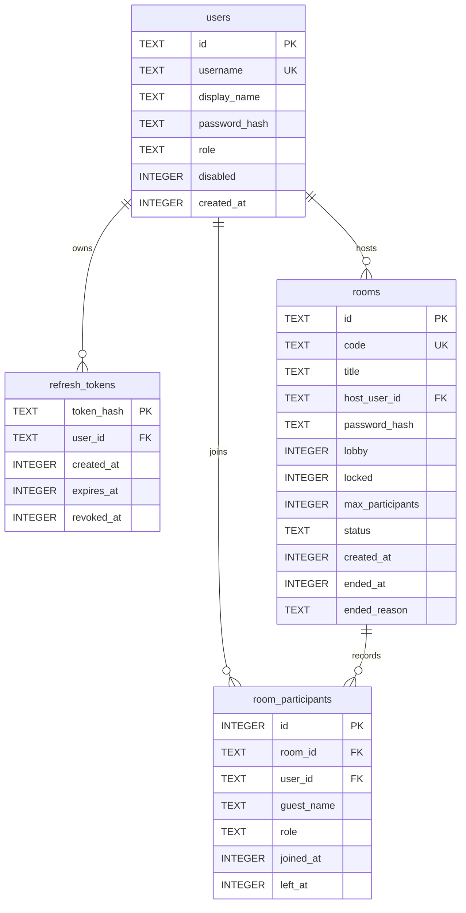

# OpenMeet 数据模型

> 服务端使用 Node 内置 `node:sqlite` ｜ 客户端使用同一驱动 ｜ 最后更新：2026-10-22

## 1. 服务端数据库

位置：`$OPENMEET_DATA_DIR/openmeet.db`（默认 `packages/server/data/openmeet.db` 或进程工作目录下 `data/`）。
连接参数：`journal_mode=WAL`、`foreign_keys=ON`、`busy_timeout=5000`、`synchronous=NORMAL`。

### 1.1 ER 图



### 1.2 DDL

```sql
CREATE TABLE IF NOT EXISTS schema_migrations (
  version INTEGER PRIMARY KEY,
  applied_at INTEGER NOT NULL
);

CREATE TABLE IF NOT EXISTS users (
  id TEXT PRIMARY KEY,
  username TEXT NOT NULL UNIQUE COLLATE NOCASE,
  display_name TEXT NOT NULL,
  password_hash TEXT NOT NULL,
  role TEXT NOT NULL DEFAULT 'user' CHECK (role IN ('admin','user')),
  disabled INTEGER NOT NULL DEFAULT 0 CHECK (disabled IN (0,1)),
  created_at INTEGER NOT NULL
);

CREATE TABLE IF NOT EXISTS refresh_tokens (
  token_hash TEXT PRIMARY KEY,
  user_id TEXT NOT NULL REFERENCES users(id) ON DELETE CASCADE,
  created_at INTEGER NOT NULL,
  expires_at INTEGER NOT NULL,
  revoked_at INTEGER,
  user_agent TEXT
);

CREATE TABLE IF NOT EXISTS rooms (
  id TEXT PRIMARY KEY,
  code TEXT NOT NULL UNIQUE,
  title TEXT NOT NULL,
  host_user_id TEXT NOT NULL REFERENCES users(id),
  password_hash TEXT,
  lobby INTEGER NOT NULL DEFAULT 0 CHECK (lobby IN (0,1)),
  locked INTEGER NOT NULL DEFAULT 0 CHECK (locked IN (0,1)),
  max_participants INTEGER NOT NULL DEFAULT 8,
  dial_in TEXT,  -- 迁移 v2：电话拨入号码；进行中的房间内唯一
  status TEXT NOT NULL DEFAULT 'active' CHECK (status IN ('active','ended')),
  created_at INTEGER NOT NULL,
  ended_at INTEGER,
  ended_reason TEXT
);

-- 迁移 v2 追加（部分唯一索引，NULL 不参与唯一约束）
CREATE UNIQUE INDEX IF NOT EXISTS idx_rooms_dial_in ON rooms(dial_in) WHERE dial_in IS NOT NULL;

CREATE TABLE IF NOT EXISTS room_participants (
  id INTEGER PRIMARY KEY AUTOINCREMENT,
  room_id TEXT NOT NULL REFERENCES rooms(id) ON DELETE CASCADE,
  user_id TEXT REFERENCES users(id) ON DELETE SET NULL,
  guest_name TEXT,
  role TEXT NOT NULL CHECK (role IN ('host','cohost','participant')),
  joined_at INTEGER NOT NULL,
  left_at INTEGER
);

CREATE INDEX IF NOT EXISTS idx_rooms_host ON rooms(host_user_id, created_at DESC);
CREATE INDEX IF NOT EXISTS idx_rooms_status ON rooms(status, created_at DESC);
CREATE INDEX IF NOT EXISTS idx_participants_room ON room_participants(room_id, joined_at);
CREATE INDEX IF NOT EXISTS idx_participants_user ON room_participants(user_id, joined_at DESC);
CREATE INDEX IF NOT EXISTS idx_refresh_user ON refresh_tokens(user_id, expires_at);
```

### 1.3 字段说明

| 表 | 字段 | 说明 |
| --- | --- | --- |
| users | `password_hash` | `scrypt$N$r$p$saltB64$hashB64` |
| users | `role` | `admin` 预留给运维接口；v0.1 首个用户可标记为 admin |
| rooms | `password_hash` | 可空；scrypt 散列，不下发 |
| rooms | `code` | 9 位大写，去除歧义字符；全局唯一 |
| rooms | `status` | 进程启动时把遗留 `active` 全部置为 `ended` |
| room_participants | `role` | 准入时角色；主持移交不追溯修改历史 |
| refresh_tokens | `token_hash` | SHA-256(refreshToken) 十六进制 |

### 1.4 查询要点

**我的会议**

```sql
SELECT r.*,
       (SELECT COUNT(*) FROM room_participants p WHERE p.room_id = r.id) AS participant_count
FROM rooms r
WHERE r.host_user_id = ?
   OR r.id IN (SELECT room_id FROM room_participants WHERE user_id = ?)
ORDER BY r.created_at DESC
LIMIT ?;
```

**启动清理**

```sql
UPDATE rooms SET status = 'ended', ended_at = ?, ended_reason = 'server_restart'
WHERE status = 'active';
UPDATE room_participants SET left_at = COALESCE(left_at, ?)
WHERE left_at IS NULL;
```

**刷新令牌轮换**（事务）

1. `SELECT` 旧令牌，检查 `revoked_at IS NULL AND expires_at > now`。
2. 若已吊销：`UPDATE refresh_tokens SET revoked_at = now WHERE user_id = ?`。
3. 正常：旧行写 `revoked_at`，插入新行。

### 1.5 数据保留

- 刷新令牌：30 天；登出/轮换即吊销；登录时机会性清理 7 天前过期的行。
- 房间与参会摘要：永久保留，供“我的会议”；不保存聊天与 SDP。
- 访客：`room_participants.user_id = NULL`，只保存当时昵称。
- 邀请令牌不落库；由 HMAC 按需派生。

### 1.6 备份

- 停机后复制 `openmeet.db` 与 `openmeet.db-wal`（或先执行 `PRAGMA wal_checkpoint(TRUNCATE)`）。
- 运行中建议使用 SQLite 在线备份；最简可靠方案是短暂停机复制。
- 迁移只前进，不回滚；升级前备份。

## 2. 客户端本地数据库

位置：`app.getPath('userData')/openmeet.db`（Windows 通常
`%APPDATA%/openmeet/openmeet.db`）。仅主进程访问。

### 2.1 DDL

```sql
CREATE TABLE IF NOT EXISTS schema_meta (
  key TEXT PRIMARY KEY,
  value TEXT NOT NULL
);

CREATE TABLE IF NOT EXISTS settings (
  key TEXT PRIMARY KEY,
  value TEXT NOT NULL,
  updated_at INTEGER NOT NULL
);

CREATE TABLE IF NOT EXISTS sessions (
  server_url TEXT PRIMARY KEY,
  username TEXT NOT NULL,
  display_name TEXT NOT NULL,
  refresh_token BLOB NOT NULL,
  token_format TEXT NOT NULL CHECK (token_format IN ('safeStorage-v1','plain-v0')),
  updated_at INTEGER NOT NULL
);

CREATE TABLE IF NOT EXISTS meetings (
  id TEXT PRIMARY KEY,
  kind TEXT NOT NULL CHECK (kind IN ('server','lan')),
  server_url TEXT,
  room_code TEXT NOT NULL,
  room_title TEXT NOT NULL,
  role TEXT NOT NULL,
  started_at INTEGER NOT NULL,
  ended_at INTEGER,
  participant_count INTEGER NOT NULL DEFAULT 0,
  chat_count INTEGER NOT NULL DEFAULT 0
);

CREATE TABLE IF NOT EXISTS chat_messages (
  id TEXT PRIMARY KEY,
  meeting_id TEXT NOT NULL REFERENCES meetings(id) ON DELETE CASCADE,
  from_peer_id TEXT,
  from_name TEXT NOT NULL,
  body TEXT NOT NULL,
  sent_at INTEGER NOT NULL,
  is_self INTEGER NOT NULL DEFAULT 0,
  client_id TEXT
);

CREATE INDEX IF NOT EXISTS idx_meetings_started ON meetings(started_at DESC);
CREATE INDEX IF NOT EXISTS idx_chat_meeting ON chat_messages(meeting_id, sent_at);
```

### 2.2 策略

| 项 | 策略 |
| --- | --- |
| schema 版本 | `schema_meta('schema_version')`，逐版本事务迁移 |
| 刷新令牌 | `safeStorage.encryptString` → BLOB；格式标记 `safeStorage-v1` |
| 降级 | safeStorage 不可用时存 UTF-8，标记 `plain-v0`，设置页显式警告 |
| 访问令牌 | 仅渲染层内存，不落盘 |
| 聊天 | 实时同步写；`is_self` 用于本地区分，`from_peer_id` 记录发送者 |
| 历史 | 进入会议写一条 `meetings`，离开更新 `ended_at/participant_count`；异常退出留下未闭合记录，启动时可清理/保留 |
| 清理 | “清除历史”删除 meetings（级联聊天）；“重置本地数据”删除全部业务表并重建 |
| 容量 | v0.1 不设上限；超过 5 万条聊天建议后续归档 |

### 2.3 设置键（约定）

| key | 值 |
| --- | --- |
| `profile.displayName` | 本地显示名 |
| `profile.avatarSeed` | 头像色彩种子（可选） |
| `device.micId` / `device.cameraId` | 默认设备 |
| `device.micOn` / `device.cameraOn` | 预检默认开关（`0/1`） |
| `network.relayOnly` | 仅走 TURN 桥接（`0/1`） |
| `network.stunUrl` | 自定义 STUN URL（可空） |
| `network.turnUrl` / `network.turnUsername` / `network.turnCredential` | 自定义 TURN |
| `session.lastServer` | 上次登录服务器 |
| `onboarding.done` | 是否完成首次引导 |

## 3. 内存数据结构（服务端）

```ts
interface LiveRoom {
  view: RoomView;
  hostUserId: string;
  passwordHash: string | null;
  peers: Map<string, Peer>;
  admittedSids: Set<string>;
  bannedSids: Set<string>;
  emptyTimer: NodeJS.Timeout | null;
  hostTimer: NodeJS.Timeout | null;
}

interface Peer {
  peerId: string;
  sid: string;
  userId: string | null;
  name: string;
  guest: boolean;
  role: Role;
  state: MediaState;
  admitted: boolean;
  joinedAt: number;
  lastSeen: number;
  socket: WebSocket;
  dbParticipantId: number | null;
}
```

活跃房间、等候状态、封禁名单均为进程内状态；重启即清空，这是 v0.1 的有意约束。
